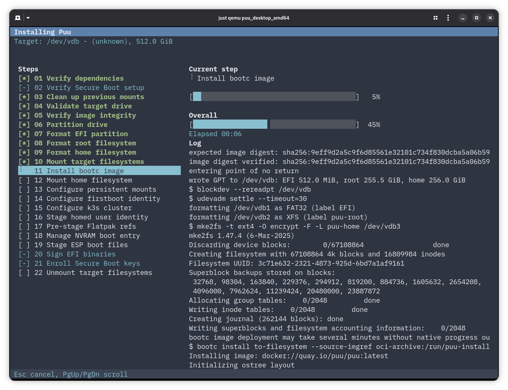

<!-- SPDX-License-Identifier: GPL-2.0-or-later -->
<!-- Copyright (C) Opinsys Oy 2026 -->

# puu-installer



Standalone installer for bootc-based OSs.

## Configuration

The installer reads a YAML configuration file. Its path is taken from
`--config-path`, or from the `PUU_INSTALLER_CONFIG` environment variable when
`--config-path` is not given. `--config-path` takes precedence over the environment
variable. Either `--config-path` or `PUU_INSTALLER_CONFIG` must be provided.

The k3s cluster token is the only k3s setting passed on the command line, via
`--k3s-token-file` (the file's first line is used). All other k3s settings live
in the configuration file.

To rebrand the installer for a different bootc OS, set `branding.name` (the
product name shown in the TUI and written as the EFI firmware boot-entry
description) and the `labels` (the on-disk root/home filesystem labels). Boot
relies on UUIDs, so the labels are cosmetic.

The defaults configuration is the following:

```yaml
branding:
  name: Puu
partitions:
  efi: 512M
  rootMin: 64G
  home: 256G
labels:
  root: puu-root
  home: puu-home
image:
  targetImgRef: quay.io/puu/puu:latest
  expectedDigest: ""       # required for local sources: sha256 of raw OCI manifest
  sourceLabel: PAYLOAD
  sourceMount: /run/puu-installer/payload
identity:
  keymap: us
  locale: C.UTF-8
  timezone: UTC
  hostname: puu
flatpak:
  manifestPath: /usr/share/puu/flatpaks.list
  syncHelper: /usr/libexec/puu/flatpak-sync
k3s:
  helper: /usr/libexec/puu/configure-k3s-cluster
  role: server          # "server" or "agent"
  serverUrl: ""         # required when role is "agent"
  nodeName: ""
homed:
  groups:
    - adm
    - audio
    - cdrom
    - dip
    - input
    - lpadmin
    - netdev
    - plugdev
    - render
    - sudo
    - video
    - wheel
    - realtime
    - uucp
serialConsole: {}       # map of machine name -> console
kernel:
  extraArm64Args:
    - cma=256M
```

## External commands

- **`bootc`**: installs the bootc image to the target filesystem.
- **`mkfs.fat`, `mkfs.xfs` and `mke2fs`**: create the target filesystems.
- **`configure-k3s-cluster`**: stages k3s cluster configuration (chrooted).
- **`flatpak-sync`**: pre-seeds system Flatpaks (chrooted into the target).

## Licensing

`puu-installer` is licensed under the `GPL-2.0-or-later` license.

Copyright (C) Opinsys Oy 2026
